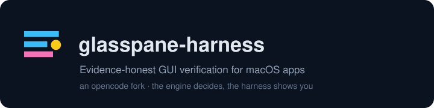

<h1 align="center">
  <code>glasspane-harness</code>
</h1>

<p align="center">
  <a href="README.md"><strong>English</strong></a> ·
  <a href="README.zh-CN.md"><strong>简体中文</strong></a>
</p>

<p align="center">
  <a href="https://www.npmjs.com/package/glasspane-harness"></a>
  
  <a href="https://github.com/jingzhao-l/glasspane-harness/actions/workflows/ci.yml"></a>
  <a href="LICENSE"></a>
  
  <a href="https://github.com/jingzhao-l/glasspane-harness"></a>
</p>

<p align="center">
  
</p>

---

## Table of Contents

- [About This Project](#about-this-project)
- [The other half of the pair: GlassPane](#the-other-half-of-the-pair-glasspane)
- [This is a complete coding agent, not a stripped one](#this-is-a-complete-coding-agent-not-a-stripped-one)
- [Product surfaces](#product-surfaces)
- [Install](#install)
- [Quick start](#quick-start)
- [The `gp_*` tool surface](#the-gp-tool-surface)
- [The evidence discipline](#the-evidence-discipline)
- [Two-way integration with iterate-harness](#two-way-integration-with-iterate-harness)
- [Documentation](#documentation)
- [Development](#development)
- [License & attribution](#license-attribution)

---

## About This Project

**The problem.** An AI agent driving a real macOS app cannot honestly say whether the UI
did what it asked. It sees its own tool output, guesses from prose, and reports success.
Screenshots don't help: they show *a* moment, not a *change*, and they cannot say whether
the change was caused by the click.

**GlassPane Harness** is a coding agent (an [opencode](https://github.com/anomalyco/opencode) upstream fork
fork) wired to a Swift verification engine through a native `gp_*` tool surface. Every
action is measured — accessibility-tree diff, pixel diff, crash and responsiveness
signals — and the engine reports **its own** attribution (`strong` / `soft` / `none`,
circuit-breaker level, pass / fail / inconclusive). The harness transcribes; it never
invents a verdict. Verified calls are appended to a hash-chained decision log, and a
compaction hook re-injects the session's evidence anchors so summarising can never quietly
drop the audit chain.

### The other half of the pair: GlassPane

This repository is one half of a two-part product. The other half is
[**GlassPane**](https://github.com/jingzhao-l/GlassPane), the macOS runtime-verification
engine: a Swift daemon that measures an application's accessibility tree, pixel changes,
crashes and responsiveness, and exposes those measurements over MCP through `glasspane-mcp`.

The split is deliberate and asymmetric:

- **GlassPane decides what the application did.** It holds the Accessibility, Input
  Monitoring and Screen Recording grants, performs the measurement, and reports its own
  attribution. This harness is a client of that verdict, not a second opinion.
- **The harness transcribes.** It carries the same `gp_*` surface natively, appends verified
  calls to a hash-chained decision log, and re-injects evidence anchors when a long session
  is compacted. It never invents a verdict.
- **Neither reads the other's private API.** Both consume the same published contract layer
  (`iterate-kernel`), so the formats that cross the boundary are one definition rather than
  two files evolving apart.

Install the engine first — the harness is a client, not a substitute:

```bash
# Engine (macOS 14+). When the permission panel opens, grant Accessibility,
# Input Monitoring and Screen Recording to `GlassPane Daemon`.
curl -fsSL https://raw.githubusercontent.com/jingzhao-l/GlassPane/main/install.sh -o /tmp/gp-install.sh && sh /tmp/gp-install.sh
```

Its README is the place for install channels, permissions, the evidence-pack format and the
update line: [jingzhao-l/GlassPane](https://github.com/jingzhao-l/GlassPane). The engine also
serves MCP hosts that are not this harness (Claude Desktop, Cursor, any MCP client), which is
what `glasspane-mcp` is for.

## This is a complete coding agent, not a stripped one

The verification wiring is the point of this fork, but it is **additive**. Everything
upstream opencode does, this harness still does — same agents, same tools, same models, same
permissions, same LSP and MCP support, same TUI and web app, same SDK and plugin API.
Nothing was cut to make room for the kernel.

That is a measured claim, not a promise. The fork tracks upstream
[anomalyco/opencode](https://github.com/anomalyco/opencode) at a pinned tag, and
`harness/tools/fork-diff.mjs` compares every file in this tree against that tag on every
change. The ruler prints its own line — this is that line, verbatim, against the golden
recorded 2026-10-18:

```
fork-diff vs v1.18.32: 4645/6724 byte-identical, 282 edited, 92 added, 1705 deleted
```

Most of what upstream ships is still byte-for-byte upstream — 4,645 of its 6,632 files. The
282 edits are concentrated in config/paths/branding, the `gp_*` tool surface, the kernel
binding, the compaction hook, and the packaging scripts. The deleted files are upstream's own
publish plumbing for channels this product does not use (ghcr images, AUR, a Homebrew tap, a
hosted console account) — plus, in 0.4.0, the first-party account surface described below.

What "additive" means in practice: if upstream ships a feature in a later release, this
fork can take it, because the feature is still here to take.

### One exception, and it is deliberate: no account, bring your own key

Upstream lets you `auth login` to an opencode account, which unlocks opencode's own
model gateway (a first-party provider in the catalog) and remote session sharing. This
product has no such account, so that surface is removed rather than shipped broken:

- upstream's `opencode` provider entry is filtered out of the model catalog
- `auth login` / `logout` / `switch`, the `/org` command and the org switcher are gone
- the `/experimental/console*` endpoints and the console-managed-provider state are gone
- session sharing to opencode's upstream cloud is gone (`share` / `autoshare` config keys too)

**Everything else in the catalog is untouched.** Anthropic, OpenAI, Google, GitHub
Copilot, Amazon Bedrock, Azure, OpenRouter and the rest are all still there — hundreds of
models — and each one is unlocked by **your own API key**, supplied by environment
variable, by the config file with an `{env:NAME}` template, or by the TUI's `/connect`
dialog. There is nothing to sign up for and nothing to log into. See
[`docs/models-and-keys.md`](docs/models-and-keys.md).

## Product surfaces

| Surface | What you get | How it ships |
|---|---|---|
| **CLI + TUI** | The agent in your terminal: interactive TUI, `run` for one-shot tasks, `serve` for headless clients | the `glasspane-harness` / `gp-harness` binaries, npm + one-click installer |
| **Web app** (embedded) | Browser UI served by the binary itself — no second process, no separate deploy | embedded in the binary (`--skip-embed-web-ui` for a CLI-only build) |
| **Docs** | This repository's `docs/` — install, tools, evidence, migration, troubleshooting | in-repo markdown (canonical; versioned with the code) |
| **SDKs** | TypeScript SDK and the plugin SDK for building your own `gp_*`-style tools | workspace packages, shipped with the tree |

Not shipped, on purpose: the upstream hosted console / enterprise stack (a private harness
has no use for an organisation-and-quota back office), the Electron desktop app (a second
batch — it needs signing and notarisation accounts), and the upstream docs *site*
(upstream's Astro/Starlight tree) is **gone from this repository**; the documentation is
`docs/`, and the console/enterprise/stats trees went with it. They were never part of
this product, and keeping them meant keeping someone else's product surface in our repo.

## Install

```bash
# npm (recommended)
npm install -g glasspane-harness

# or bun
bun add -g glasspane-harness

# or one-click (npm first, GitHub release asset as fallback)
curl -fsSL https://raw.githubusercontent.com/jingzhao-l/glasspane-harness/v0.12.2/scripts/install.sh | bash
```

Two commands are installed: **`glasspane-harness`** and the short alias **`gp-harness`**.

Some package managers do not run install scripts by default, and the wrapper's
`postinstall` is what places the real binary. Measured on 0.7.0: npm installs fine (npm 11+
may print an `allow-scripts` notice on the first install; the command still works), while
`bun add -g` skips that step and the command then prints its own remedy — from 0.7.7 that
line names this install's own directory, so running it verbatim is the fix. See
[docs/install.md](docs/install.md#channels).

**macOS only.** The engine, the permission model and the evidence pipeline exist only on
macOS, so the npm distribution is macOS-only too: the package declares `os: darwin` and
npm refuses the install elsewhere instead of handing you a binary that cannot run. There
is no Linux or Windows build, by decision, not by omission.

Prerequisites: macOS 13+ (Apple silicon or Intel), and — for the `gp_*` tools — the **GlassPane** background
service running with Accessibility granted ([install GlassPane](https://github.com/jingzhao-l/GlassPane);
the installer prints the exact next steps). Without the engine every `gp_*` call answers
`GP_E_ENGINE_UNREACHABLE` with a remedy — that is the engine's word, not the installer's.

If npm's global prefix is not writable, use
`npm install -g --prefix "$HOME/.local" glasspane-harness` and put `~/.local/bin` on PATH;
the installer detects that failure and prints this remedy itself.

## Quick start

```bash
glasspane-harness                                  # interactive TUI (the embedded web UI is served too)
glasspane-harness run "attach to Notes, type a heading, then tell me whether the UI proved it"
glasspane-harness serve --port 4096                # headless server; the web app is served from it
glasspane-harness --help
```

The first thing to ask any session for is `gp_probe_status`: it reports the engine
version, advertised capabilities and permission state — and every remedy the tool surface
emits points back at it.

## The `gp_*` tool surface

| Tool | What it does | Permission |
|---|---|---|
| `gp_probe_status` | engine self-report: version, capabilities, accessibility / input-monitoring / screen-recording / developer-tools state | prompts (diagnostic entry point) |
| `gp_attach` | attach to a running app by bundle id or pid | prompts |
| `gp_observe` | snapshot the attached window's accessibility tree (digest, node count) | prompts |
| `gp_act` | perform one accessibility action and return what the engine observed changing (op id ties it to an evidence pack) | prompts (moves a real app) |
| `gp_diagnose` | classify an operation from its pack (contaminated / out-of-band / callback / pre-existing / no-change) | prompts |
| `gp_last_evidence` | fetch the evidence pack the engine archived for an operation | prompts |

Whether a method exists is read from the running engine (`hello.capabilities`) — the list
is never hard-coded here, because it grows upstream of this file. Full reference:
[`docs/tools.md`](docs/tools.md).

## The evidence discipline

1. **Judgement stays in Swift.** Attribution, diagnosis class, circuit-breaker level and
   the pass / fail / inconclusive outcome are computed by the GlassPane engine. The
   harness transcribes; it never derives. A CI ratchet fails when a tool surface grows a
   threshold, a pixel verdict or a pass/fail synthesis.
2. **What the model reads is what the engine said.** Error codes and agent-executable
   remedies go into the tool's `output` string, not only into metadata.
3. **The audit chain is a product feature.** Verified calls are appended to a hash-chained
   decision log (op id ↔ entry hash); the fixed points re-compute the chain with two
   independent hashers, so the ledger can be verified without trusting the writer.
4. **Compaction may not erase evidence.** The compaction hook injects the session's
   evidence anchors into the summarisation prompt; absence is stated as arithmetic
   (`gp_* calls: N · decisions recorded: M`), never assumed.

Details: [`docs/evidence.md`](docs/evidence.md).

## Two-way integration with iterate-harness

GlassPane Harness is one side of a second pair. The engine answers "did that operation really
take effect?"; [iterate-harness](https://github.com/jingzhao-l/iterate-harness) answers "is this
code right?". The two do not talk through a chat log — everything that crosses the boundary is
written by one side as a verifiable record and read by the other.

- **Same chain format, verified before quoting.** Every decision recorded from an evidence pack
  is appended to a hash-chained ledger (`~/.local/share/glasspane-harness/decisions.jsonl`, or
  wherever `GLASSPANE_DECISION_LOG` points). The review loop writes `.iterate/decision-log.jsonl`
  in the project under review in the same chain format, so a claim quoted from the other side's
  file is chain-verified first: a rewritten line is refused with the number of the line where the
  chain stops. The production reader today is the loop's (`fix_proof`); this fork ships the same
  verifier, and a fixed-point test pins that a chain written by the loop verifies here. A project
  can name the loop's ledger as its fix-evidence source once, with
  `ih iterate glasspane-ledger <absolute path>` — the link is written only after the whole chain
  verifies, and it pins the chain's first entry, so a replaced ledger stops qualifying.
- **A review dimension travels with the call.** Five `gp_*` tools take an optional `dimension`
  argument — `gp_act`, `gp_observe`, `gp_diagnose`, `gp_last_evidence`, `gp_attach` — and they are
  the same five on both surfaces. The engine never sees the word: the declaration is stripped
  before a request leaves, and this harness echoes it back. A decision that contradicts what was
  already witnessed for that operation id is refused (`KERNEL_E_DIMENSION_CONTEST`).
- **A failed re-check goes back to the app.** When a round's invariant re-check fails, the loop
  asks the running application again, read-only, through the host's MCP transport. It builds one
  `gp_last_evidence` plus one `gp_diagnose` per recorded operation; the allow-list is the five
  read-only tools, and a call that would mutate the app is refused by name.
- **Compaction knows what was reviewed.** The compaction hook re-injects the session's evidence
  anchors (operation id, outcome, ledger line, entry hash). The run plan (`.iterate/run-plan.json`
  or `GLASSPANE_RUN_PLAN`) decides which dimension history is dropped first, and declarations that
  could not reach an anchor are counted rather than assumed.
- **A fix is not accepted on the agent's word.** Before advancing a repair recipe, the gate reads
  this round's invariant verdict, the project's recipe (`GLASSPANE_RECIPE`), and a chain-verified
  ledger line recording a passing outcome against an operation id. Anything absent or unmeasured
  is refused by name (`RECIPE_GATE_E_*`). The answer is recorded in the project's ledger; a
  contract refusal writes no ledger bytes. Both doors read it back: `ih iterate gate` in a
  terminal, `/iterate gate` in a session.
- **Both tool surfaces speak one provider contract.** This fork and the MCP shell register the
  same provider id and the same prerequisites per method, and a gate that runs both registrations
  reddens when they diverge.

What stays where it belongs: the engine decides what the application did; neither harness judges
an interface on its own. The gate reports and withholds — it does not run the recipe, because
neither product ships a recipe executor. The formats above come from one published contract
layer, [`iterate-kernel`](https://www.npmjs.com/package/iterate-kernel), and the boundary is
stated honestly: whether the two implementations still agree on a case the corpus never wrote
down is answered by `scripts/diff_kernel_implementations.py`, an operator command rather than a
CI step. The exchange from the loop's side is documented in the iterate-harness README
([Two-way integration with GlassPane](https://github.com/jingzhao-l/iterate-harness#-two-way-integration-with-glasspane)),
and from the engine's side in [GlassPane's two-way integration section](https://github.com/jingzhao-l/GlassPane#two-way-integration-with-the-review-loop).
Implementation detail: [`docs/kernel-integration.md`](docs/kernel-integration.md) and
[`docs/evidence.md`](docs/evidence.md).

## Documentation

- [`docs/install.md`](docs/install.md) — install paths, permissions, verification
- [`docs/models-and-keys.md`](docs/models-and-keys.md) — the model catalog and how to supply
  your own API keys
- [`docs/tools.md`](docs/tools.md) — the `gp_*` surface, argument by argument
- [`docs/evidence.md`](docs/evidence.md) — attribution, diagnosis, the decision log
- [`docs/migrate-from-opencode.md`](docs/migrate-from-opencode.md) — what the fork changed versus upstream
  customisation changed, and what deliberately stayed
- [`docs/release.md`](docs/release.md) — cutting a release, and the npm trusted-publisher
  setup
- [`docs/kernel-integration.md`](docs/kernel-integration.md) — the shared kernel, how it
  reaches this fork as a pinned `iterate-kernel` dependency, and how much of the two-way
  integration exists today
- [`docs/troubleshooting.md`](docs/troubleshooting.md) — engine unreachable, permission
  denials, the `GP_E_*` codes
- [`FORK.md`](FORK.md) / [`SYNCLOG.md`](SYNCLOG.md) — the fork's coordinates, discipline
  and per-batch measurements; [`NOTICE`](NOTICE) — attribution;
  [`CHANGELOG.md`](CHANGELOG.md) — what shipped in each version

## Development

```bash
bun install                # workspace (on TLS-intercepting networks bun needs
                           # NODE_EXTRA_CA_CERTS — see FORK.md)
bun run typecheck           # per package
bun test --timeout 30000    # fixed-point tests (from packages/opencode)
cd packages/opencode && bun run build --single   # product build: CLI + TUI + embedded web app
```

`build` is a script in `packages/opencode/package.json`; the workspace root has no `build`
script, so the last command must run from that package — from the root it dies with
`Script not found "build"`, which is failure #1 of the four recorded in
[docs/release.md](docs/release.md).

The repo-side gates live in the GlassPane repository under `harness/` (hook-liveness,
fork-diff, kernel-pin, tool-surface, surface-semantics, product-surface,
brand-surface); their rationale, negative controls and known boundaries are documented in
`harness/README.md`. Every customisation commit carries the `[gp]` prefix.

## License & attribution

MIT, like upstream. `LICENSE` is upstream's, unchanged; [`NOTICE`](NOTICE) records what
this fork changed and where the code came from. Upstream:
[anomalyco/opencode](https://github.com/anomalyco/opencode) `v1.18.32` © SST — without
them this product does not exist, and `FORK.md` exists so that claim stays true for
every future sync.

